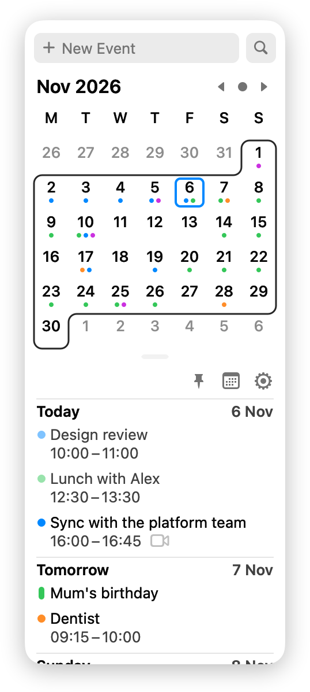
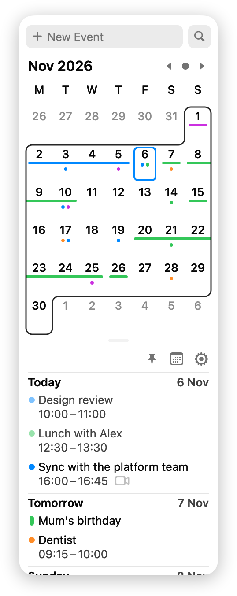
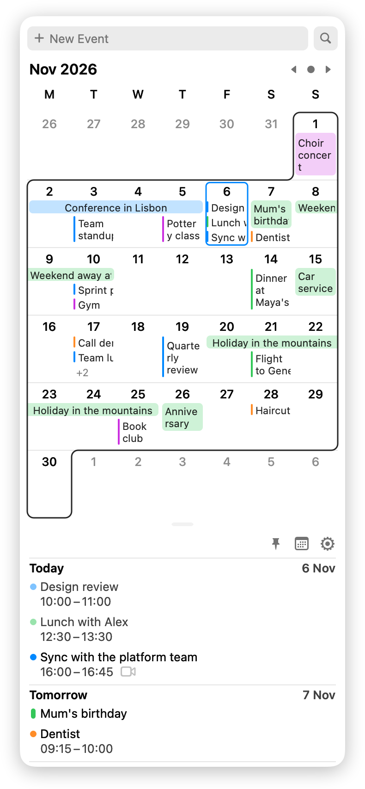
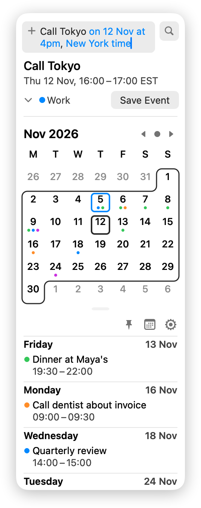
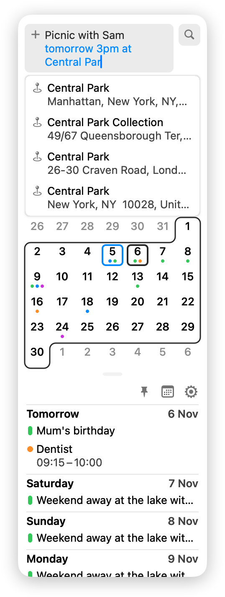
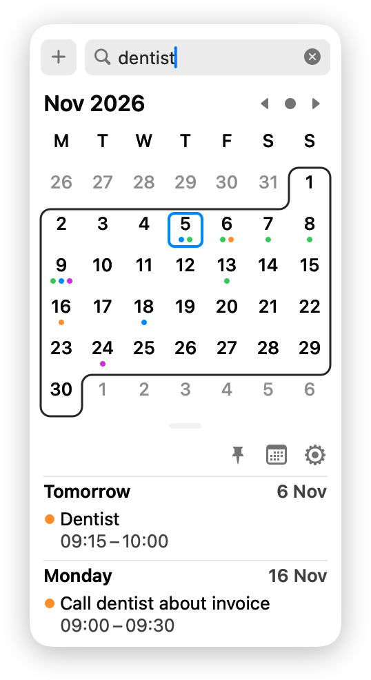

# Spidercal

Forked from [Itsycal](https://github.com/sfsam/Itsycal)

<table>
  <tr>
    <td align="center" valign="top">Calendar and agenda<br></td>
    <td align="center" valign="top">Events as lines<br></td>
    <td align="center" valign="top">Event titles in the calendar<br></td>
  </tr>
  <tr>
    <td align="center" valign="top">Type an event in plain language<br></td>
    <td align="center" valign="top">Place suggestions as you type<br></td>
    <td align="center" valign="top">Search your events<br></td>
  </tr>
</table>

- Type events in natural language, e.g. `Call Tokyo on 12 Nov at 4pm, New York time`. Understood dates, times, time zones and places are tinted, and a summary appears under the field. Press Return to save.
- Time zones in new events: `New York time`, `Tokyo time`, `japanese time`, `uk time`, `PST` and so on, plus a Time Zone row in the event form.
- Place suggestions while typing `at <place>` or filling in the location field. They use Apple's MapKit, so the place text you type is sent to Apple. Nothing is sent until you type a place.
- Search events by title, location or notes across the next 12 months. The New Event and Search fields swap places with a click, or with ⌘N and ⌘F.
- The full event form opens inline in the window instead of in a popover.
- Three ways to show events in the calendar, under Settings → Appearance → Show events as: Dots, as in Itsycal; Lines, with a line across the days of each all-day or multi-day event; and Details, with each event's title in its day.
- The agenda is a scrolling list. Drag the window's bottom edge to make it taller or shorter, and double-click the edge to reset it.
- Slightly wider calendar, and spacing and type sizes that follow the size setting throughout.
- Removed the Sparkle auto-updater, which checked Itsycal's update feed. To update, download the latest release or rebuild from source.

**Install instructions**

[Download Spidercal.dmg](https://github.com/notpaulmartin-forks/spidercal/releases/latest/download/Spidercal.dmg) (macOS 26 or newer, Apple silicon and Intel), open it and drag Spidercal to Applications.

This build isn't notarized by Apple, so macOS blocks it the first time you open it. Try to open it once, then go to System Settings → Privacy & Security and click Open Anyway. Or run this in Terminal:

```bash
xattr -dr com.apple.quarantine /Applications/Spidercal.app
```

Allow calendar access when asked, then tick the calendars you want under Settings → Events. Nothing shows until you do.

To build it yourself instead, you need Xcode 26 or newer:

```bash
git clone https://github.com/notpaulmartin-forks/spidercal.git
cd spidercal
cp Local.xcconfig.example Local.xcconfig
xcodebuild -project Itsycal.xcodeproj -scheme Itsycal -configuration Release -derivedDataPath build build
ditto build/Build/Products/Release/Spidercal.app /Applications/Spidercal.app
open /Applications/Spidercal.app
```

The Xcode project and source folder are still named Itsycal, to keep merging from upstream simple. The Help button in the alert that asks you to move the app to Applications still opens Itsycal's site.

# Original Itsycal README

I've learned a lot by looking at other people's code so
maybe someone can learn something from looking at mine.

= = = = = = = =

Itsycal is a tiny calendar for your Mac's menu bar.

If you want, it will display your calendar events as a
companion to the Mac Calendar app. You can also create
and delete (but not edit) events.

For more info, see: http://www.mowglii.com/itsycal

= = = = = = = =

This project uses a local xcconfig file for signing -
see CONTRIBUTING.md and Local.xcconfig.example

MIT Licensed - see License file
